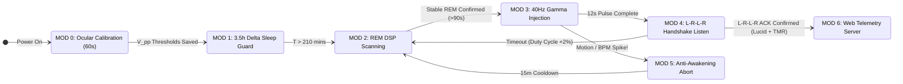

<div align="center">

# 🧠 Project HYPNOS
### Closed-Loop Biopotential Telemetry & 40Hz Gamma Neuro-Modulation Interface

[](https://opensource.org/licenses/MIT)
[]()
[]()
[]()
[]()

*A non-invasive cyber-physical neuro-telemetry system for real-time REM detection, 40 Hz frontotemporal Gamma entrainment, and bidirectional dream-to-hardware ocular communication.*

---

[📌 Abstract](#-1-abstract--problem-statement) •
[🔬 Physics & Biology](#-2-theoretical-framework-physics--neurobiology) •
[📚 Literature](#-3-peer-reviewed-scientific-validation-literature) •
[🛠️ Hardware & BOM](#️-4-hardware-architecture--bill-of-materials-bom) •
[💻 DSP & Firmware](#-5-software-architecture--dsp-pipeline) •
[🔍 Failure Analysis](#-6-comparative-failure-analysis-why-legacy-commercial-masks-failed)

</div>

---

## 📌 1. Abstract & Problem Statement

Commercial sleep masks claiming to induce lucid dreaming (e.g., *Remee*, *Aurora*) have historically failed due to an **open-loop (blind timer)** architecture. Firing optical stimuli after a fixed countdown (e.g., 4.5 hours) without physiological feedback inevitably targets Non-REM Deep Sleep (Delta wave dominance), where the thalamic sensory gate blocks external inputs, or light sleep, causing premature awakening.

**Project HYPNOS** is a closed-loop, non-invasive cyber-physical neuro-telemetry system. It detects **Rapid Eye Movement (REM)** sleep in real-time by cross-referencing:
1. **Corneo-Retinal Dipole Potentials (EOG)**
2. **Infrared Ocular Displacement (940nm Reflectance)**
3. **Skeletal Muscle Atonia (6-Axis IMU)**
4. **Autonomic Heart Rate Variability (PPG)**

Upon confirming stable phasic REM sleep, the system injects phase-locked **40 Hz Gamma-band sensory stimuli** ($650\text{ nm}$ deep-red photic pulses and bone-conducted binaural acoustic beats) to entrain the **Dorsolateral Prefrontal Cortex (DLPFC)**, inducing real-time metacognitive awareness (lucidity) and enabling **two-way ocular communication** between the dreamer and the microcontroller.

---

## 🔬 2. Theoretical Framework: Physics & Neurobiology

### 2.1. Biophysics of the Corneo-Retinal Standing Potential (EOG)
The human eye acts as a biological electrical dipole. Due to high metabolic activity in the retinal pigment epithelium, the **cornea (front)** maintains a positive electrical potential ($+0.4\text{ mV}$ to $+1.0\text{ mV}$) relative to the **retina (back)**. 

As the eyeball rotates by an angle $\theta$ during REM saccades, the dipole vector shifts, creating a measurable microvolt potential difference $\Delta V$ across surface electrodes placed at the lateral canthi (temples):

$$\Delta V(\theta) \propto \frac{p \cdot \cos(\theta)}{4 \pi \varepsilon r^2}$$

Where:
* $p$ = Corneo-retinal dipole moment
* $\varepsilon$ = Biological tissue permittivity
* $r$ = Radial distance to the differential surface electrodes

### 2.2. Optical Reflectance & Beer-Lambert Tissue Penetration
For non-contact ocular tracking and photic stimulation through closed eyelids, wavelength selection is governed by the optical absorption coefficient ($\mu_a$) and reduced scattering coefficient ($\mu_s'$) of hemoglobin and melanin. According to the **Modified Beer-Lambert Law**:

$$I(d) = I_0 \cdot e^{-\left(\mu_a(\lambda) + \mu_s'(\lambda)\right) \cdot d}$$

Blue and green wavelengths ($400\text{–}550\text{ nm}$) are heavily absorbed by blood capillaries in the palpebral (eyelid) tissue and suppress melatonin via melanopsin ganglions. **Deep Red ($650\text{ nm}$) and Near-Infrared ($940\text{ nm}$)** sit squarely within the **Biological Optical Window**, achieving maximum transmittance through the $\approx 1.5\text{ mm}$ eyelid tissue without triggering circadian disruption.

### 2.3. Neurobiology of REM Atonia & Thalamic Gating
* **Pontine Motor Inhibition (REM Atonia):** During REM sleep, the *sublaterodorsal nucleus (SLD)* in the brainstem pons excites inhibitory interneurons in the ventromedial medulla, releasing **Glycine** and **GABA** onto spinal alpha-motor neurons. This induces complete paralysis of skeletal muscles while sparing the **extraocular muscles** (controlled by cranial nerves III, IV, and VI) and the diaphragm.
* **40 Hz Gamma Frontotemporal Entrainment:** In standard REM sleep, the visual association cortex and limbic system are hyperactive, while the **Dorsolateral Prefrontal Cortex (DLPFC)**—responsible for executive logic, working memory write-operations, and self-awareness—is deactivated. Delivering external **40 Hz steady-state sensory stimuli** induces neural phase-locking (Gamma synchronization) in the frontotemporal network, restoring prefrontal metacognition without terminating the REM state.

---

## 📚 3. Peer-Reviewed Scientific Validation (Literature)

The core engineering parameters of Project HYPNOS are strictly derived from validated clinical neuroscience studies:

| Study & Authors | Publication & DOI | Core Clinical Finding & Hardware Translation |
| :--- | :--- | :--- |
| **Voss, U., Holzmann, R., Hobson, A., et al. (2014)** | *Nature Neuroscience*, 17(6), 810–812.<br>[`DOI: 10.1038/nn.3719`](https://doi.org/10.1038/nn.3719) | Frontotemporal stimulation specifically at **40 Hz** (and to a lesser extent 25 Hz) triggered immediate lucid awareness in sleeping subjects, whereas lower frequencies ($2\text{–}12\text{ Hz}$) produced zero effect. |
| **Konkoly, K. R., Appel, K., Chabani, E., et al. (2021)** | *Current Biology*, 31(7), 1417–1427.<br>[`DOI: 10.1016/j.cub.2021.01.026`](https://doi.org/10.1016/j.cub.2021.01.026) | Demonstrated across four independent laboratories that individuals in REM sleep can perceive external cues, perform math calculations inside the dream, and transmit answers back to hardware using pre-agreed **L-R-L-R EOG eye-movement codes**. |
| **Carr, M., Konkoly, K., Mallett, R., et al. (2020)** | *Psychology of Consciousness*, 10(4), 413–430.<br>[`DOI: 10.1037/cns0000227`](https://doi.org/10.1037/cns0000227) | Combining pre-sleep cognitive training with closed-loop visual and auditory cues during verified REM epochs yielded a **$>50\%$ lucid dream induction rate**. |

---

## 🛠️ 4. Hardware Architecture & Bill of Materials (BOM)

### System Block Diagram
```text
                       +---------------------------------------------------+
                       |                POWER & ISOLATION                  |
                       |  [3.7V LiPo] -> [TP4056] -> [MCP1700-3302E LDO]   |
                       +-------------------------+-------------------------+
                                                 | Clean 3.3V Rail (+100nF Decoupling)
+------------------------------------------------+------------------------------------------------+
| SENSORY FRONT-END (INPUTS)                     v                                                |
|                                       +-----------------+                                       |
| [EOG Ag/AgCl Electrodes] -> [AD8232] ->| A0 (Diff/Single)|                                       |
|                                       |   TI ADS1115    |===(I2C: 400kHz)===> +---------------+ |
| [QRE1113 940nm IR Optic] ------------>| A1 (16-Bit ADC) |                     |               | |
|                                       +-----------------+                     |   ESP32-S3    | |
| [MAX30102 PPG Sensor]    =====================(I2C)=========================> | Dual-Core MCU | |
| [MPU6050 6-Axis IMU]     =====================(I2C)=========================> |               | |
+-------------------------------------------------------------------------------+-------+-------+ |
                                                                                        |         |
+---------------------------------------------------------------------------------------+-------+ |
| NEURO-MODULATION ACTUATORS (OUTPUTS)                                                  v       | |
|                                                                                               | |
| [Left/Right 650nm SMD LEDs] <--- [1.5kΩ Current Limiter] <--- (Hardware PWM: 40Hz) <-- GPIO25 | |
| [Bone Conduction Transducer]<--- [MAX98357A I2S Amp]     <--- (40Hz Binaural DSP)  <-- I2S    | |
+-------------------------------------------------------------------------------------------------+
```

### Detailed Pinout & Component Specifications

| Subsystem | Component | Interface / Pin | Technical Specification & Purpose |
| :--- | :--- | :--- | :--- |
| **Main MCU** | `ESP32-S3-WROOM-1` | Dual-Core Xtensa LX7 | **Core 0:** $128\text{ Hz}$ ADC sampling & DSP filtering.<br>**Core 1:** State machine, PWM generation, Web Telemetry. |
| **Precision ADC** | `TI ADS1115` | I2C (`0x48`) / GPIO 21, 22 | 16-Bit Sigma-Delta ADC with internal PGA ($\pm 0.256\text{V}$ range, $7.81\mu\text{V}$ LSB resolution). Eliminates ESP32 ADC non-linearity. |
| **Biopotential AFE** | `AD8232` / `BioAmp EXG` | Analog Out $\rightarrow$ ADS1115 `A0` | Instrumentation Amplifier ($G = 100\text{ V/V}$), $\text{CMRR} > 80\text{ dB}$ to reject $50\text{ Hz}$ mains hum. High-pass filter at $0.5\text{ Hz}$. |
| **Optical REM Tracker** | `QRE1113` ($940\text{nm}$ IR) | Analog Out $\rightarrow$ ADS1115 `A1` | Non-contact corneal bulge tracking. $150\Omega$ IR LED anode resistor, $10\text{k}\Omega$ phototransistor pull-up. |
| **Atonia Detector** | `MPU6050` | I2C (`0x68`) / GPIO 21, 22 | 3-Axis Accelerometer + Gyroscope. Detects somatic stillness ($\sigma_{\text{acc}}^2 < 0.002g$) confirming brainstem paralysis. |
| **Autonomic Monitor** | `MAX30102` | I2C (`0x57`) / GPIO 21, 22 | Optical pulse oximetry & HRV. Detects sympathetic autonomic shifts characteristic of phasic REM. |
| **Photic Stimulator** | `4x 0603 SMD LEDs` | GPIO 25, 26 (LEDC PWM) | $650\text{ nm}$ Deep Red. Series $1.5\text{k}\Omega$ resistor restricts current to $< 1\text{ mA}$ for subliminal palpebral penetration. |
| **Acoustic Stimulator** | `Bone Conduction Piezo` | I2S (GPIO 16, 17, 18) | Driven by `MAX98357A` Class-D Amp. Delivers $200\text{ Hz}$ (L) / $240\text{ Hz}$ (R) phase-shifted $40\text{ Hz}$ Gamma beats via temporal bone. |
| **Low-Noise Power** | `MCP1700-3302E LDO` | Power Rail ($3.3\text{V}$) | Ultra-low dropout regulator ($1.6\mu\text{A}$ quiescent current, zero switching ripple) to prevent analog ADC corruption. |

---

## 💻 5. Software Architecture & DSP Pipeline

### 5.1. Digital Signal Processing (DSP) Conditioning
Raw signals sampled from the `ADS1115` at $f_s = 128\text{ Hz}$ undergo real-time conditioning on **Core 0**:

1. **50 Hz / 60 Hz IIR Notch Filter:** Removes ambient AC power-line interference.
2. **2nd-Order Butterworth Band-Pass Filter ($0.5\text{ Hz} - 8.0\text{ Hz}$):**
   * *High-Pass ($0.5\text{ Hz}$):* Strips DC baseline wander caused by skin-electrode impedance drift and galvanic skin response (sweating).
   * *Low-Pass ($8.0\text{ Hz}$):* Eliminates high-frequency facial electromyography (EMG) artifacts and thermal noise, isolating purely saccadic eye movements.
3. **Velocity Derivative Detection:** Rapid eye movements (REM saccades) are distinguished from slow rolling eye movements (NREM Stage 1) by evaluating the discrete first derivative of the conditioned voltage signal:

$$\frac{dV}{dt} \approx \frac{V[n] - V[n-1]}{\Delta t} > \Gamma_{\text{saccade}}$$

### 5.2. Finite State Machine (FSM) Architecture



#### `MODE 0: STATE_OCULAR_CALIBRATION` (Boot + First 60s)
* **Operation:** Upon wearing the mask, the user performs a deliberate **Left-Right-Left-Right (LRLR)** maximal eye sweep with closed eyes.
* **Algorithm:** The MCU measures the peak-to-peak voltage swing ($V_{\text{pp}}$) on `ADS1115_A0/A1` and dynamically sets two personal parameters in NVS flash:
  * $\text{REM\_SACCADE\_THRESHOLD} = 0.35 \times V_{\text{pp}}$
  * $\text{HANDSHAKE\_CONFIRM\_THRESHOLD} = 0.75 \times V_{\text{pp}}$

#### `MODE 1: STATE_DELTA_SLEEP_GUARD` ($T + 0\text{h}$ to $T + 3.5\text{h}$)
* **Operation:** Enters ESP32 Light-Sleep mode for the first 210 minutes.
* **Rationale:** Human sleep architecture prioritizes Slow-Wave Sleep (NREM Stage 3 Delta waves, $0.5\text{–}4\text{ Hz}$) for physical restoration and glymphatic clearance during the first two sleep cycles. Stimulating during this window degrades sleep quality without yielding lucidity.

#### `MODE 2: STATE_REM_DETECTION` (Active Biometric Scanning)
* **Operation:** Evaluates a sliding 10-second window. To transition to stimulation, **all three conditions (Logical AND)** must hold true continuously for **90 seconds** (ensuring stable phasic REM):
  1. **Somatic Atonia:** IMU acceleration variance $\sigma_{\text{acc}}^2 < 0.002g$ (Zero head/body movement for $> 3\text{ minutes}$).
  2. **Ocular Saccade Density:** At least $N \ge 6$ zero-crossing derivative peaks exceeding `REM_SACCADE_THRESHOLD` within the 10s window.
  3. **Autonomic Sympathetic Shift:** Instantaneous heart rate shows elevated variability (RMSSD fluctuation) and a baseline increase of $+3\text{ to }+8\text{ BPM}$ compared to NREM baseline.

#### `MODE 3: STATE_40HZ_GAMMA_INJECTION` (Neuro-Modulation)
* **Operation:** Initiates phase-locked multimodal stimulation:
  * **Optical:** Hardware timer (`ledc`) drives the $650\text{ nm}$ LEDs at exactly $f = 40.0\text{ Hz}$ ($T = 25\text{ ms}$, $10\%$ duty cycle) using a modulated envelope (2 seconds ON, 2 seconds OFF for 12 seconds).
  * **Acoustic:** Bone conduction transducer outputs a sub-awakening $40\text{ Hz}$ isochronic/binaural pulse.
* **Phenomenology:** The stimulus bypasses the retinal periphery and integrates into the ongoing dream narrative (e.g., flickering ambient sky, flashing vehicle dashboard) while simultaneously boosting prefrontal $40\text{ Hz}$ Gamma coherence.

#### `MODE 4: STATE_BIDIRECTIONAL_HANDSHAKE` (Dream-to-MCU Comms)
* **Operation:** For 30 seconds post-stimulation, the DSP core listens specifically for the **Konkoly Protocol (2021)** ocular signature: **4 consecutive full-amplitude alternating peaks (Left-Right-Left-Right)** executed within a $2.5\text{ s}$ window.
* **Action on Match (`HANDSHAKE_ACK`):**
  1. Immediately terminates optical flashing to prevent over-stimulation/awakening.
  2. Logs timestamped `LUCID_EPOCH_CONFIRMED` to SPIFFS memory.
  3. Optionally initiates **Targeted Memory Reactivation (TMR)**: Plays pre-recorded audio cues or study prompts at ultra-low volume ($+2\text{ dB}$ above ambient threshold) into the lucid state.
* **Adaptive Ramping:** If no handshake is detected within 30s and the user remains in REM, the system waits 5 minutes and increments PWM brightness duty cycle by $+2\%$ (Dynamic Habituation Compensation).

#### `MODE 5: STATE_ANTI_AWAKENING_GUARD` (Hardware Interrupt)
* **Operation:** Runs asynchronously at the highest FreeRTOS priority (`configMAX_PRIORITIES - 1`).
* **Trigger:** If `MPU6050` detects a micro-arousal ($\Delta a > 0.05g$) or `MAX30102` detects a sudden tachycardia spike ($\Delta \text{BPM} > +15$) during Mode 3, all actuators are killed within $< 2\text{ ms}$ and the system enters a 15-minute cooldown to preserve sleep continuity.

#### `MODE 6: STATE_TELEMETRY_SERVER` (Post-Sleep Analysis)
* **Operation:** Triggered via onboard button upon waking.
* **Output:** Spins up an asynchronous local Web Server (`AsyncWebServer`) hosting an interactive `Chart.js` dashboard displaying full-night hypnograms, EOG voltage traces, REM epoch timestamps, and successful bidirectional handshake markers.

---

## 🔍 6. Comparative Failure Analysis: Why Legacy Commercial Masks Failed

Early crowdfunding campaigns and legacy commercial sleep masks (most notably *Remee*, *Aurora*, and *Luwon*) generated massive public interest but largely failed in real-world user trials. A rigorous systems-engineering post-mortem reveals four critical architectural flaws in legacy devices, each systematically resolved in **Project HYPNOS**:

| Architectural Flaw | Legacy Commercial Masks (e.g., *Remee*) | Project HYPNOS Engineering Resolution |
| :--- | :--- | :--- |
| **1. Open-Loop "Blind Timer" Architecture** | **No physiological sensors.** Legacy masks rely on a static countdown timer (e.g., waiting 4.5 hours) before firing LED patterns. Because human sleep cycles vary wildly ($70\text{–}120\text{ min}$), stimuli almost always fire during **NREM Stage 3 (Deep Delta Sleep)**—where the thalamic gate completely blocks visual input—or during light NREM, causing immediate awakening. | **Multi-Modal Closed-Loop Telemetry:** HYPNOS never guesses. It fires stimuli *only* when three physiological conditions are simultaneously verified via 16-bit ADC DSP: **Somatic Atonia** (`MPU6050`), **Saccadic Eye Movements** (`EOG`/`IR`), and **Autonomic Sympathetic Shift** (`MAX30102`). |
| **2. Lack of Prefrontal Cortical Entrainment** | Legacy devices flash arbitrary spatial patterns (e.g., sweeping left-to-right red dots) at low frequencies ($1\text{–}5\text{ Hz}$). Even if the user perceives the light inside the dream (e.g., seeing a red traffic light), the **Dorsolateral Prefrontal Cortex (DLPFC)** remains offline, so the user lacks the executive logic to realize they are dreaming. | **Phase-Locked 40 Hz Gamma Stimulation:** Instead of decorative LED sweeps, HYPNOS drives hardware PWM timers at exactly **40.0 Hz** (coupled with $40\text{ Hz}$ bone-conducted binaural beats). Per *Voss et al. (2014)*, $40\text{ Hz}$ directly entrains frontotemporal Gamma coherence, forcibly waking up the brain's logic center inside the dream. |
| **3. Sensory Habituation & Over-Stimulation** | Fixed-intensity LEDs quickly suffer from neural habituation (the brain filters out repetitive static stimuli after a few nights) or over-stimulate the retina, jolting the user out of REM sleep entirely. | **Bidirectional Handshake & Dynamic Ramping:** Once the user becomes lucid and executes the **L-R-L-R ocular handshake**, HYPNOS immediately kills the LEDs to preserve the dream state. If no handshake occurs, PWM duty cycle dynamically increments by $+2\%$ on subsequent epochs, while the **Anti-Awakening Guard** aborts stimulation within $<2\text{ ms}$ if a micro-arousal is detected. |
| **4. Single-Modality (Visual-Only) Bottleneck** | Relying strictly on palpebral LED penetration fails when the sleeper's head shifts into the pillow or during REM epochs with high visual cortex saturation. | **Sensor & Actuator Fusion:** Combines $650\text{ nm}$ optical penetration with **temporal bone-conduction acoustics**, ensuring the $40\text{ Hz}$ synchronization signal reaches the thalamocortical network regardless of sleep posture. |

---

## 📂 7. Proposed Repository Directory Structure

```text
Project-HYPNOS/
├── hardware/
│   ├── schematics/           # KiCad 8.0 circuit schematics (AFE, LDO, MCU)
│   ├── pcb_layout/           # 2-Layer Flexible PCB Gerber files for mask integration
│   └── enclosure_3d/         # STL files for sensor pods & temple bone-conduction mounts
├── firmware/
│   ├── src/
│   │   ├── main.cpp          # FreeRTOS task allocation (Core 0: DSP, Core 1: FSM)
│   │   ├── dsp_filters.cpp   # 50Hz Notch & 0.5-8Hz Butterworth IIR implementation
│   │   ├── rem_detector.cpp  # Saccade derivative & IMU atonia fusion engine
│   │   ├── stimulator.cpp    # 40Hz LEDC hardware PWM & I2S audio synthesis
│   │   └── handshake.cpp     # L-R-L-R ocular pattern recognition state machine
│   └── platformio.ini        # PlatformIO build configuration for ESP32-S3
├── dashboard/
│   └── index.html            # Embedded SPIFFS Web UI for morning hypnogram telemetry
├── docs/
│   └── clinical_papers/      # Reference PDFs (Voss 2014, Konkoly 2021, Carr 2020)
└── README.md
```

---

## ⚠️ 8. Safety & Bio-Engineering Disclaimers

> [!CAUTION]
> **Galvanic Isolation Requirement:** The system must operate **exclusively on internal DC battery power ($3.7\text{V}$ LiPo)** while worn on the head. **Never** wear Ag/AgCl surface electrodes connected to the cranium while the microcontroller is tethered to mains-powered USB chargers or non-isolated benchtop power supplies.

> [!WARNING]
> **Photosensitive Epilepsy Warning:** $40\text{ Hz}$ stroboscopic photic stimulation can provoke seizures in individuals with photosensitive epilepsy. Ensure hardware current-limiting resistors ($1.5\text{k}\Omega$) remain in place and PWM duty cycles operate strictly at sub-awakening micro-luminescence levels ($< 1\text{ mA}$ LED drive current).

---

<div align="center">
  <sub>Built for Open-Source Neuro-Engineering & Consciousness Research • Licensed under MIT. Noxa Corporation </sub>
</div>
